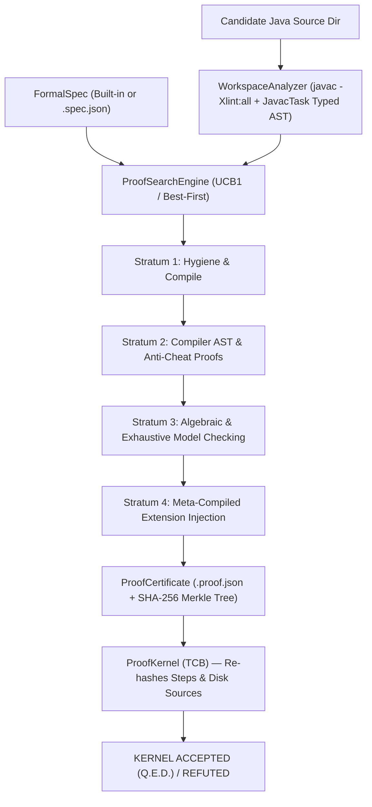
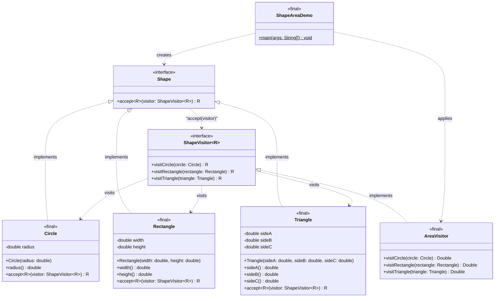
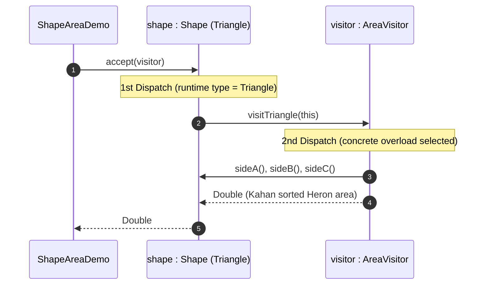
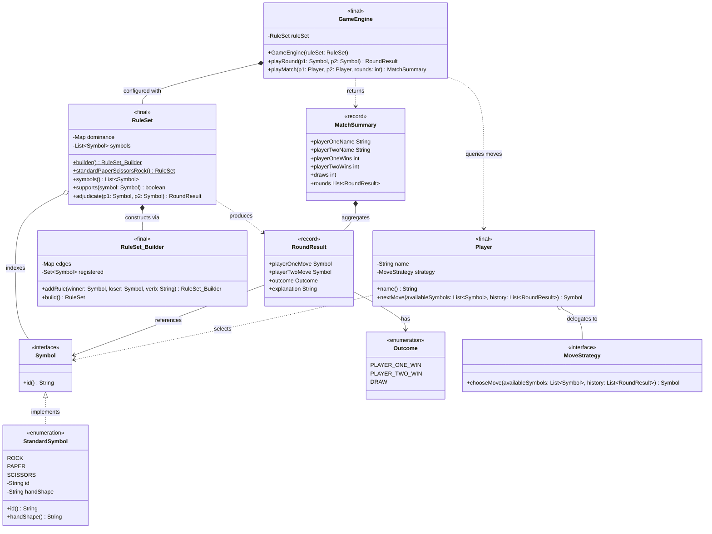

# OOPProof-Java: Formal Proof Engine for Classic Java OOP Designs

An **AlphaProof-inspired formal verification & proof-certification engine** for Java object-oriented and systems designs. Given a Java source directory and a formal specification (built-in or declarative `.spec.json`), **OOPProof-Java** searches for concept bindings, verifies compiler-AST structural rules, checks algebraic and finite-domain invariants, compiles synthetic client extensions against the public API without modifying existing files, and emits a SHA-256 Merkle-chained **Proof Certificate** independently checked by a minimal **Trusted Computing Base (`ProofKernel`)**.

---

## Architecture & Verification Pipeline



| Component | Role | Implementation |
|---|---|---|
| **Compiler & Typed AST** | Isolated compilation (`-Xlint:all`), hygiene check (zero `.class`/`.jar` in source deliverables), `JavacTask` typed AST & `javax.lang.model` symbol graph | [`WorkspaceAnalyzer.java`](src/main/java/dev/oopproof/core/WorkspaceAnalyzer.java), [`AstQueries.java`](src/main/java/dev/oopproof/core/AstQueries.java) |
| **Proof Search Engine** | UCB1 / Best-First search over candidate concept bindings (`@SHAPE_BASE`, `@VISITOR_BASE`, `@SYMBOL_TYPE`, `@CACHE_IMPL`) and ordered tactic strata | [`ProofSearchEngine.java`](src/main/java/dev/oopproof/core/ProofSearchEngine.java) |
| **4-Strata Tactics** | 1. Hygiene & Compile<br>2. AST Double Dispatch, Anti-`instanceof` & Encapsulation<br>3. Geometry Invariants & Exhaustive Game Model Checking<br>4. Synthetic Extension Meta-Compilation | [`tactics/`](src/main/java/dev/oopproof/tactics/) |
| **Trusted Proof Kernel (TCB)** | Independently verifies step Merkle hashes, disk source SHA-256 manifest, and evidence completeness | [`ProofKernel.java`](src/main/java/dev/oopproof/core/ProofKernel.java) |
| **Declarative Specs** | Built-in specs (`oop-visitor-shapes`, `oop-paper-scissors-rock`) plus `.spec.json` specs with role discovery, trace oracles, and `{{ROLE}}` Java probes | [`GenericJsonSpec.java`](src/main/java/dev/oopproof/spec/GenericJsonSpec.java), [`specs/lru-cache.spec.json`](specs/lru-cache.spec.json) |

---

## How the Compiler AST Verification Works

Unit tests only observe black-box return values—they cannot tell whether `AreaVisitor` genuinely uses Visitor double dispatch or hides `if (shape instanceof Circle)` branches. Regex or text search is equally brittle because comments, formatting, and variable renames fool it.

Instead, **OOPProof-Java** uses the JDK's official Compiler Tree API (`jdk.compiler`):

1. **Parse & Type-Analyze ([`WorkspaceAnalyzer.java`](src/main/java/dev/oopproof/core/WorkspaceAnalyzer.java))**:
   - Invokes `JavacTask.parse()` to build full `CompilationUnitTree` syntax trees and `JavacTask.analyze()` to resolve semantic types (`Trees`, `Elements`, `Types`).
   - Records exact source file SHA-256 digests and compiles bytecode into an isolated temporary directory without modifying the candidate folder.
2. **Double-Dispatch Proof ([`AstQueries.verifyDoubleDispatch`](src/main/java/dev/oopproof/core/AstQueries.java))**:
   - Scans each concrete shape's `accept(visitor)` `MethodTree` using `TreePathScanner`.
   - Resolves the invoked `MethodInvocationTree` via `trees.getElement(path)` and verifies three semantic conditions:
     - The target method belongs to `ShapeVisitor` (or a supertype).
     - Its parameter type is assignable from the concrete shape (`Circle`, `Rectangle`, or `Triangle`).
     - The argument passed is literally `this` (e.g. `visitor.visitCircle(this)`).
3. **Anti-Shortcut & Encapsulation Proofs ([`AstQueries.findForbiddenTypeDispatch`](src/main/java/dev/oopproof/core/AstQueries.java))**:
   - Walks every compilation unit to prove zero `InstanceOfTree`, `PatternCaseLabelTree` (`case Circle c ->`), `Object.getClass()`, or `Class.forName()` dispatches exist on the target hierarchy outside `Object.equals(Object)`.
   - Verifies all non-constant instance fields are `private` via `ElementFilter.fieldsIn(...)`.

---

## Classic OOP Demos & UML Diagrams

### 1. Visitor Pattern: Shape Hierarchy & `AreaVisitor` ([`solutions/visitor-shapes/`](solutions/visitor-shapes/))

- Generic stateless visitor (`<R> R accept(ShapeVisitor<R>)`), immutable self-validating shapes (`Circle`, `Rectangle`, `Triangle` enforcing strict triangle inequality), and Kahan's sorted Heron formula in `AreaVisitor` for needle-triangle precision.
- Extensibility check synthesizes `SyntheticPerimeterVisitor`, compiles it against `ShapeVisitor<R>` with zero edits to candidate files, and verifies perimeters.





### 2. Generalized Paper Scissors Rock ([`solutions/paper-scissors-rock/`](solutions/paper-scissors-rock/))

- Separates an open `Symbol` interface from `StandardSymbol`, models rules as an immutable directed dominance graph (`RuleSet` with build-time irreflexivity and antisymmetry checks), and decouples player move selection via `MoveStrategy`.
- Exhaustively verifies all `3 × 3 = 9` matchups (totality, draw reflexivity, zero-sum antisymmetry, determinism), then externally synthesizes a 5-symbol **Rock-Paper-Scissors-Lizard-Spock** extension and checks all `25` matchups without modifying engine code.



### 3. Declarative Spec & Counterexample Suite

- **Bounded $O(1)$ LRU Cache** ([`specs/lru-cache.spec.json`](specs/lru-cache.spec.json) + [`solutions/lru-cache/`](solutions/lru-cache/)) — demonstrates problem-agnostic `.spec.json` verification via role discovery, trace scenarios, and 250-step randomized differential fuzzing against a reference model.
- **Counterexamples Suite** ([`solutions/counterexamples/`](solutions/counterexamples/)) — three flawed implementations that pass naive happy-path tests but are **REFUTED** by OOPProof-Java:
  1. `test1-instanceof-cheat` — caught by `INSTANCEOF_DISPATCH` AST check + failed `SyntheticPerimeterVisitor` compilation.
  2. `test1-broken-triangle` — caught constructing `Triangle(1, 2, 10)` without throwing `IllegalArgumentException`.
  3. `test2-hardcoded-switch` — caught failing 5-symbol RPSLS generalization (`closed enum` + hardcoded switch).

---

## Quick Start

Requires **JDK 21+** (tested on OpenJDK 25):

```bash
chmod +x run.sh
./run.sh
```

### CLI Usage

```bash
# List built-in specifications
java -cp build/classes dev.oopproof.Main specs

# Prove Classic OOP 1 (Visitor Shape Hierarchy) and save ProofCertificate + Lean-style trace
java -cp build/classes dev.oopproof.Main prove \
  --spec oop-visitor-shapes \
  --target solutions/visitor-shapes \
  --cert build/visitor.proof.json \
  --trace build/visitor.proof.lean

# Prove any arbitrary OOP/data-structure problem via declarative .spec.json
java -cp build/classes dev.oopproof.Main prove \
  --spec specs/lru-cache.spec.json \
  --target solutions/lru-cache

# Independently verify a ProofCertificate against source files on disk
java -cp build/classes dev.oopproof.Main verify \
  --cert build/visitor.proof.json \
  --target solutions/visitor-shapes
```

## Further Reading

- [LinkedIn Article: Your Java Code Passes the Tests. Can You Prove It’s Extensible?]([docs/linkedin-article.md](https://www.linkedin.com/pulse/your-java-code-passes-tests-can-you-prove-its-extensible-feiyu-lu-6tlhc/))
